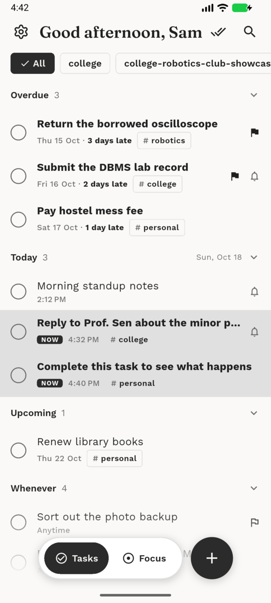
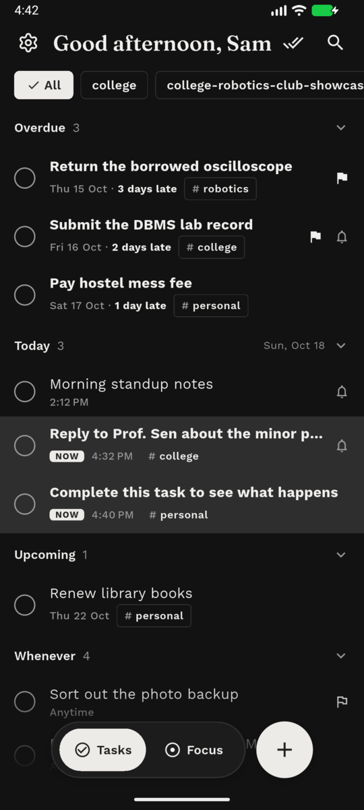
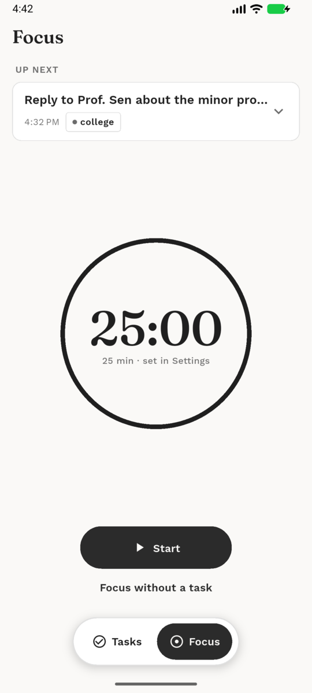
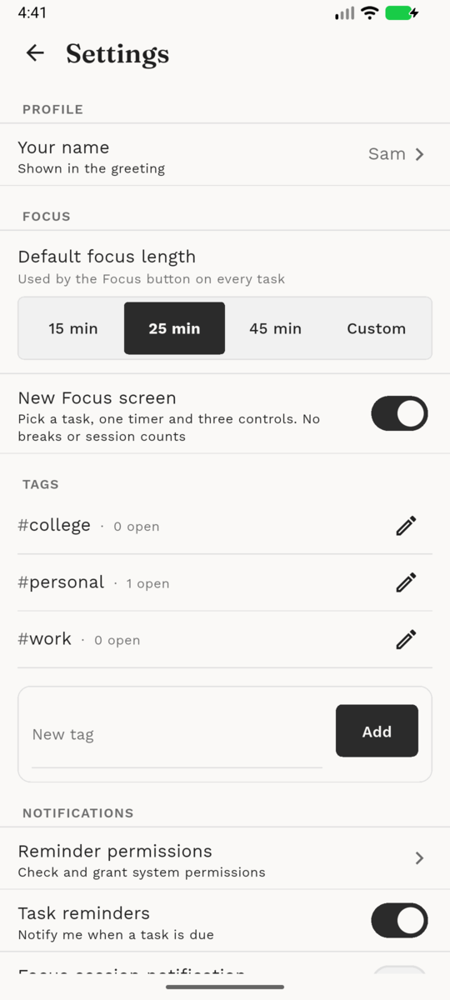

# bloop

A small, personal to-do application built with Flutter.

This app was created primarily for my girlfriend to keep track of what she needs to do and when she needs to do it during college. I plan to maintain this project for as long as she is in college and actively using it.

This is not a commercial product, not a startup idea, and not a polished productivity app. It is a simple, honest utility built quickly to solve a real, personal problem.

---

## About the Project

- Built in **one night (approximately 3-4 hours),**, hence certainly NOT polished
- Focused on simplicity and reliability
- Local-first, no account or cloud dependency
- Designed to be easy to extend later

Because of the short build time, the app is **not fully furnished** and intentionally avoids over-engineering.

---

## Current Features

- Create, edit, and delete tasks
- Optional date and time, with reminders
- Priority levels (Low / Medium / High)
- Home list grouped into Overdue, Today, Upcoming, Whenever and Completed
- Tags, with filter chips on the home screen and tag management in Settings
- Tap a task to Focus on it, snooze it for an hour, or move it to tomorrow
- A Focus timer with optional sounds and scenery
- Light and dark themes in a clean monochrome design
- Works offline; the optional Focus sounds and scenery are downloaded the first time you pick them (after asking)
- Local data persistence, with export and import as JSON

---

## Screenshots

  
  
  
  

---

## Plans for the project:

The following are the features planned:

- [x] Notifications / reminders
- [x] Tags and tag-based filtering
- [x] Focus elements
- [ ] Colour (tag colours and accent colours), tracked in [#16](https://github.com/saad-mh/bloop/issues/16)

Everything else in the app works as intended.

---

## Required Permissions

- Set Exact Alarms(Android 13+)
- Allow notifications

---

## Tech Stack

- Flutter
- Localized Notifications(since I'm based in Kolkata, India, this project contains traces of localization defaults to that)
- Local storage (Hive)

No backend, no authentication, no cloud sync.

---

## Project Status

This project is actively maintained but intentionally kept simple.

Updates will be made:
- When lethal bugs are found
- When my girlfriend needs new features
- When there is free time to improve stability or UX

There is no fixed roadmap or release schedule.

---

## Download

Signed APKs are attached to each [release](https://github.com/saad-mh/bloop/releases/latest). Bloop is Android only, and needs Android 7.0 or newer.

**Which file do I install?**

| If you are... | Install | Size |
|---|---|---|
| Not sure, or just want it to work | `bloop-2.0.0-universal.apk` | about 61 MB |
| On a modern phone (almost every phone since about 2017) | `bloop-2.0.0-arm64-v8a.apk` | about 23 MB |
| On an old or low-end 32-bit phone | `bloop-2.0.0-armeabi-v7a.apk` | about 21 MB |
| Running an Android emulator on a PC | `bloop-2.0.0-x86_64.apk` | about 25 MB |

The universal file contains all of the others and works on any device, so it is the safe choice. The smaller ones are the same app with only the parts your phone uses.
If you picked one that doesn't fit your phone, Android says "App not compatible" and nothing breaks; try the universal one.

Verify a download against `SHA256SUMS.txt` on the release page if you like.

Updating from 1.x? 2.0.0 is signed with a new key, so Android won't install it over 1.x. Use Settings > Advanced > Export data in 1.x first, uninstall it, install 2.0.0, then use Import data.

---

## Build Notes

- This app was built quickly as a functional prototype
- Code prioritizes clarity over abstraction
- Some parts may be refactored later as features grow
- Not optimized for scale or large datasets

---

## License

This project is personal and shared for reference and learning purposes, or if you want to contribute.

Use, fork, or modify at your own discretion.

---

## Final Note

This app exists because it was needed, not because it was planned.

Thank you for your interests.

